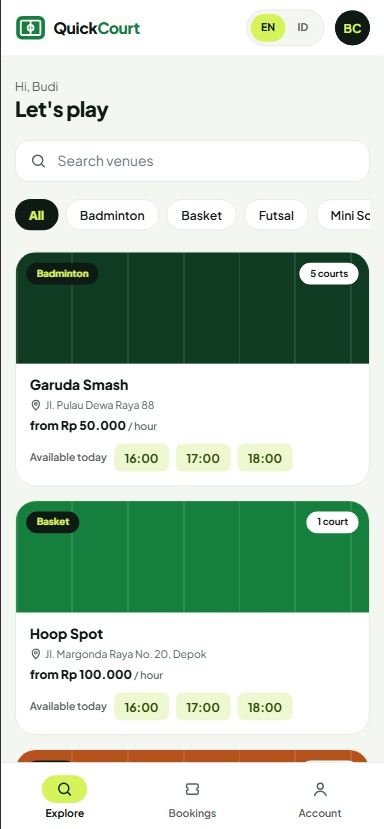
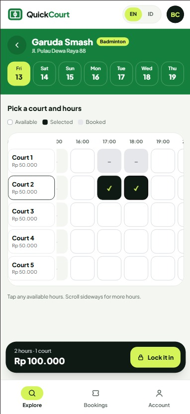
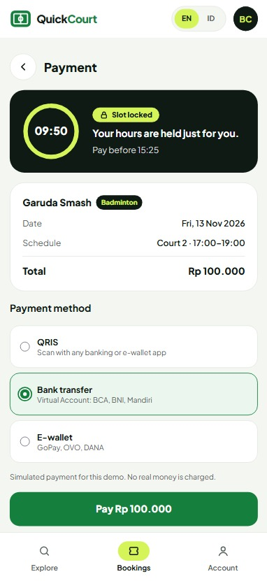
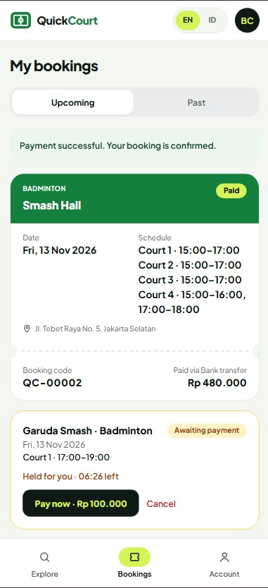
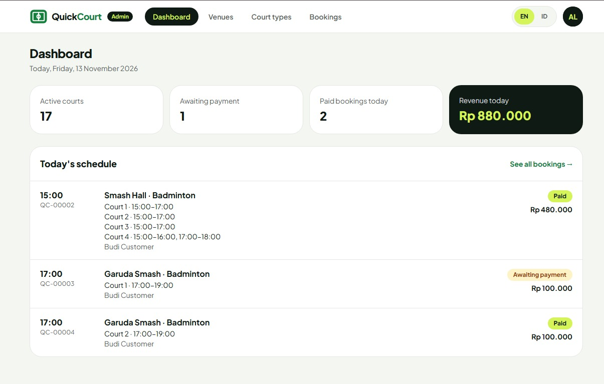
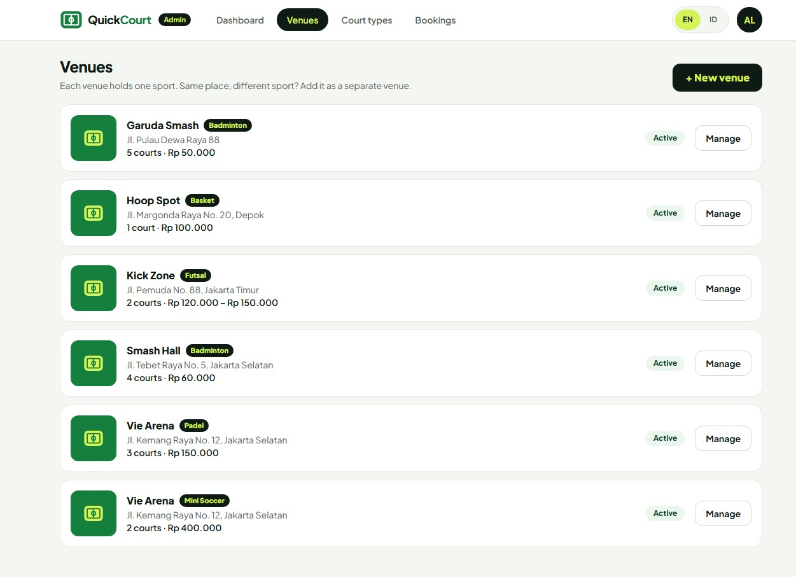
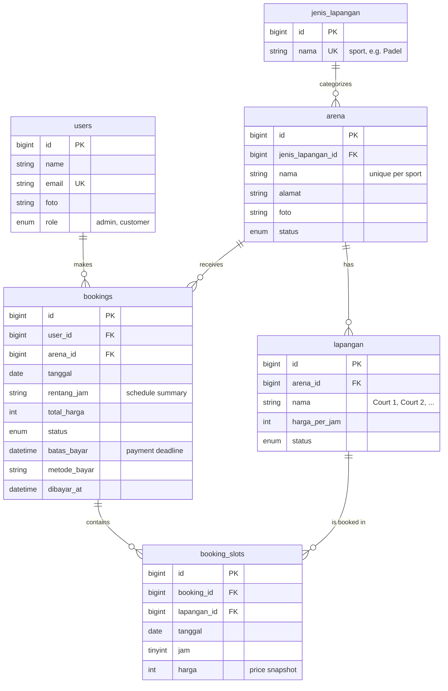

# QuickCourt

**Book a sports court in seconds.** QuickCourt is a court booking web app where customers pick a venue, choose hours on one or more courts, lock the slots for 10 minutes, and pay before anyone else grabs them. Admins manage venues, courts, prices, and bookings from their own dashboard.

Built with Laravel, MySQL, Tailwind CSS and Alpine.js. Available in English and Indonesian.



## Screenshots

| Pick courts and hours                          | Payment (slot locked)                     | Booking ticket                          |
| ---------------------------------------------- | ----------------------------------------- | --------------------------------------- |
|  |  |  |

| Admin dashboard                                           | Admin venue detail                                |
| --------------------------------------------------------- | ------------------------------------------------- |
|  |  |

## Features

**Customers**

- Browse venues by sport, search by name or area, and see the next available hours for today
- Pick any available hours on one or more courts in a venue, consecutive or not, in a single booking
- Selected slots are held for 10 minutes while the customer pays
- Simulated payment (QRIS, bank transfer, e-wallet) that confirms the booking instantly
- Booking tickets with booking codes, plus booking history
- Profile with photo upload
- English / Indonesian language switch

**Admins**

- Dashboard with today's schedule, unpaid bookings, and revenue
- Create a venue and generate its courts automatically (Court 1, Court 2, ...)
- Set a price and status for each court
- Manage court types (sports)
- View, filter, and cancel bookings

## Technical highlights

**No double booking, even under concurrent requests**
Every booked hour is stored as its own row in `booking_slots`, with a unique constraint on `(court, date, hour)`. All slots of a booking are inserted in one database transaction. If two customers try to book the same hour at the same time, the database rejects the second insert and the whole booking is rolled back.

**Temporary slot holds**
A new booking starts as `awaiting payment` with a 10-minute deadline. Expired bookings are cleaned up before every read that depends on availability: their status becomes `expired` and their slots are released.

**Safe state changes**
Payment and cancellation use conditional updates (`UPDATE ... WHERE status = 'awaiting payment' AND deadline > now`), so a booking can't be paid after it expired or cancelled twice.

**Prices are calculated on the server**
The total is computed from each court's price in the database, never from the form. The price of every hour is also saved on the slot (a price snapshot), so changing a court's price later doesn't change past bookings.

**Access control**
Admin pages are protected by a role-based middleware. Customers can only see, pay, or cancel their own bookings.

**Two languages**
All UI text goes through Laravel's translator, with Indonesian translations in `lang/id.json` and Indonesian validation messages in `lang/id/validation.php`.

## Database design



Table and column names are in Indonesian: `arena` = venue, `lapangan` = court, `jenis_lapangan` = court type / sport, `tanggal` = date, `jam` = hour, `harga` = price.

A venue holds one sport. The same place offering two sports is stored as two venues (for example, _Vie Arena_ for Padel and _Vie Arena_ for Mini Soccer).

## Tech stack

- **Backend:** Laravel 13, PHP 8.3
- **Database:** MySQL
- **Frontend:** Blade, Tailwind CSS, Alpine.js, Vite
- **Auth:** Laravel Breeze
- **Testing:** PHPUnit feature tests

## Getting started

Requirements: PHP 8.3, Composer, Node.js, and MySQL (for example via XAMPP).

```bash
git clone https://github.com/<enricodamario>/quickcourt.git
cd quickcourt

composer install
npm install

cp .env.example .env
php artisan key:generate
```

Create a database named `booking_lapangan`, then set the connection in `.env`:

```env
DB_CONNECTION=mysql
DB_DATABASE=booking_lapangan
DB_USERNAME=root
DB_PASSWORD=
```

Run the migrations with demo data, link the storage folder, build the assets, and start the server:

```bash
php artisan migrate --seed
php artisan storage:link
npm run build
php artisan serve
```

Open http://127.0.0.1:8000.

### Demo accounts

| Role     | Email             | Password |
| -------- | ----------------- | -------- |
| Admin    | admin@example.com | password |
| Customer | budi@example.com  | password |

## Running the tests

The tests use a separate MySQL database named `booking_lapangan_test` (see `phpunit.xml`). Create it first, then run:

```bash
php artisan test
```

The tests cover booking creation, price calculation, multi-court bookings, double-booking prevention, payment and expiry, access control, venue management, and profile photo upload.

## Notes

- Payment is simulated for demo purposes. No real money is charged.
- Expired bookings are cleaned up when pages are loaded rather than by a background job, which keeps the app simple to run locally.
